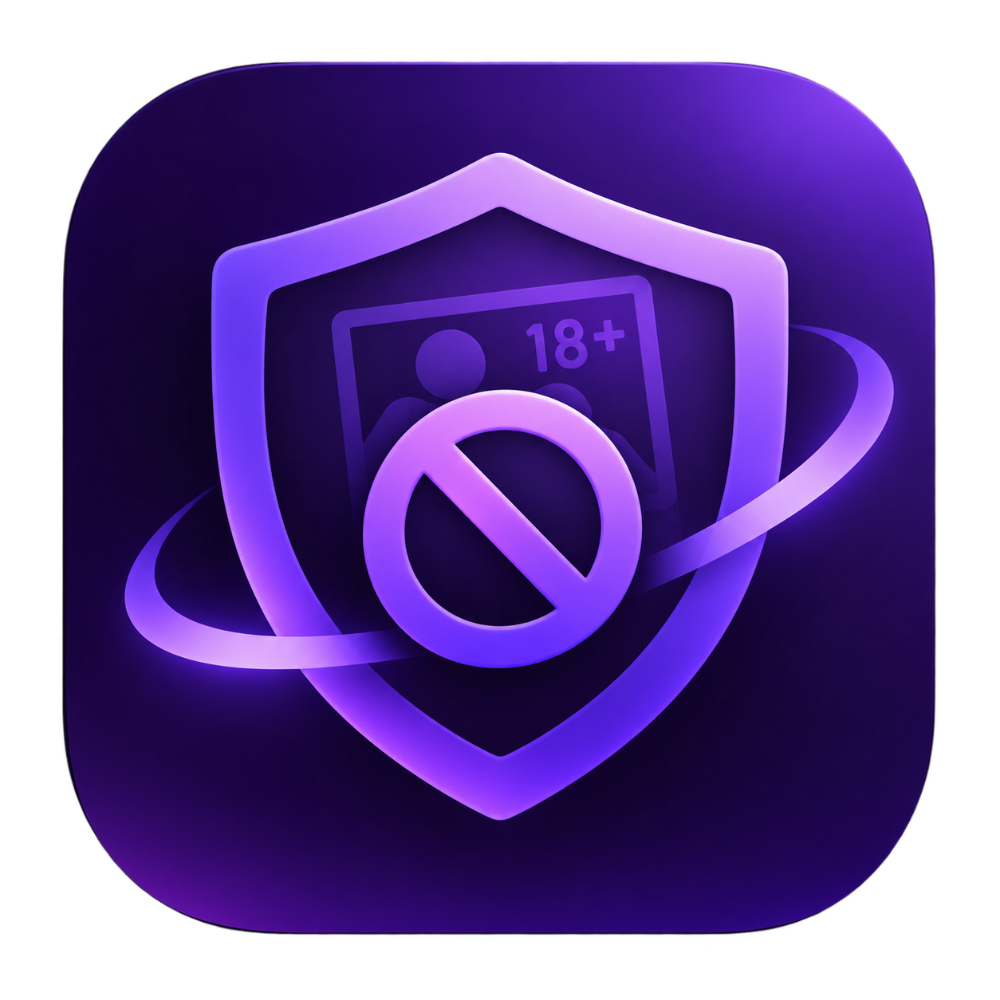

<p align="center">
  
</p>

<h2 align="center">Blocker</h2>

A tamper-resistant, system-wide DNS content filter for Linux.</br>
Brought to you by <b>[Shell Ninja](https://github.com/shell-ninja)</b> — who didn't trust themselves with sudo rights.</br>

---

Blocker is a high-performance C++ system-wide content filter for Linux that pairs kernel-level DNS filtering and filesystem protections with enterprise-enforced, unremovable browser policies and local WebExtensions. It intercepts blocked sites before connections occur and removes in-app temptation surfaces without allowing user removal, DevTools tampering of policy extensions, or Incognito bypass. Rebooting doesn't help bypass it either; unlock countdowns require authorization and aging.

## How it works

- **Kernel & DNS Level Proxy**: Runs a local DNS proxy on `127.0.0.1:53` — blocked domains resolve to loopback, while legitimate traffic forwards to Cloudflare Families (`1.1.1.3`).
- **HTTP Landing Page Redirection**: Blocked sites receive a clean `302` redirect to a customizable landing page rather than a broken connection error.
- **Unremovable Browser Extension Guard**: Deploys a local Manifest V3 extension force-installed via root-owned Linux Browser Enterprise Policies (`ExtensionInstallForcelist` & `ExtensionSettings`). Protected with filesystem immutability (`chattr +i`) and daemon watchdog self-healing.
  - Served locally via an internal, root-managed background daemon (`blocker-crxserve.service` on `127.0.0.1:19288`) — no Chrome Web Store dependency or external network calls required.
  - Blocks Incognito mode and Guest profiles to prevent evasion.
  - **Web Developer Friendly**: Configures `DeveloperToolsAvailability: 1`, allowing full DevTools and Inspect Element access for web development on ordinary web pages while keeping enterprise force-installed extensions tamper-proof.
- **Reddit Mature Content Guard**:
  - Forcefully turns "Show mature content (I'm over 18)" **OFF by default** and locks it.
  - Proactively resets mature content preferences to `false` via GraphQL / REST preference sync on account login or page load.
  - Overwrites `over18` cookies to `0`.
  - Hooks `window.fetch` and `XMLHttpRequest` with synchronous fast paths to rewrite responses and prevent mature preference activation.
  - Recursively traverses open Shadow DOM roots to disable mature switches, intercept composed click events, and automatically close confirmation modals.
- **Reddit Search Media Blocker & Adult Keyword Shield**:
  - Completely strips the "Media" and "Video" tabs (`type=media`) from Reddit search results.
  - Removes inline search media carousels, video preview cards, and media grids so adult media never renders during searches.
  - Intercepts and redirects adult search queries (`pawg`, `porn`, `xxx`, `nsfw`, `hentai`, `gonewild`, etc.) before execution via DeclarativeNetRequest rules and client-side History SPA navigation hooks.
  - Normalized stem, tokenized, and substring matching prevents circumvention (e.g. `pawgs`, `milfpawg`).
  - Search result post filtering automatically hides posts originating from blocked subreddits or flagged adult/NSFW.
- **Instagram Explore Blocker & Zero-Flash UI Stripper**:
  - Blocks `instagram.com/explore` and subpaths via DeclarativeNetRequest, client-side History SPA navigation wrappers, and browser policy `URLBlocklist`.
  - Injects pre-paint CSS immediately hiding the Explore navigation compass icon and wrapper across desktop, tablet, and mobile-web layouts with zero visual flash.
  - Keeps Home feed, Direct Messages, Reels, Notifications, and Profiles fully functional.
- **Ultra-Lean Network & Browser Performance**:
  - Enterprise URL blocklists are trimmed to essential endpoints (~35 entries), avoiding browser startup hangs and rendering stutter caused by bloated multi-thousand entry policies.
  - Synchronous bypass in fetch/XHR hooks ensures regular browsing requests incur zero microtask overhead.
- **Night Curfew & Auto-Shutdown**:
  - Automatically powers off the PC at a user-configured time (default 12:00 AM / 00:00) and keeps it unusable until morning (default 03:00 AM).
  - Issues dynamic desktop alerts and terminal warnings at 30m, 15m, 5m, and 1m remaining to ensure plenty of time to save your work.
- **Tamper Resistance & Systemd Watchdogs**:
  - Rules are stored scrambled in a root-only vault (`/var/lib/blocker/vault.enc`) — no readable plain-text file to delete.
  - Systemd watchdogs (`blocker.service`, `blocker-guard.timer`, `blocker-crxserve.service`) restart killed processes within 1 second; manual `systemctl stop` is refused (`RefuseManualStop=yes`).
  - Critical binaries, systemd units, CRX packages, and enterprise policy configurations are locked with Linux filesystem immutability (`chattr +i`).
  - Any change that loosens protection (removing rules, stopping services, uninstalling) requires a password **and** an unlock waiting period. The timer resets on every reboot.

## Requirements

- Linux with systemd (Debian, Ubuntu, Fedora, Arch, etc.)
- `g++` ≥ 9 (or `clang` ≥ 10) and GNU `make`
- Python 3 (for extension packing and local crxserve daemon)
- Chromium-based browser (Brave, Chrome, Chromium) or Firefox
- No third-party C++ libraries

## Install

Clone the repo and run the setup script. It builds, packs the extension, installs enterprise policies, and verifies everything in one step.

```sh
git clone https://github.com/shell-ninja/blocker.git
cd blocker
chmod +x setup.sh
sudo ./setup.sh
```

For the full accountability setup (let someone else hold the password):

```sh
sudo ./setup.sh --random-password --delay-hours 72 --curfew-time 23:30
```

The script will:
1. Verify system requirements and toolchains
2. Build the C++ binary (`build/blocker`)
3. Pack the local Shield WebExtension (`shield.crx`) and register root browser enterprise policies
4. Deploy the local extension update server (`blocker-crxserve.service`)
5. Ask for confirmation and optional curfew auto-shutdown schedule
6. Enable and start the systemd services with immutable filesystem protection
7. Verify that DNS blocking and desktop notifications work

## Setup options

| Option | What it does |
|---|---|
| `--random-password` | Generate a 24-character password (print once, hand to someone else) |
| `--delay-hours N` | Hours to wait after `unlock-request` before changes are allowed (default 24) |
| `--mode password\|delay\|both` | How changes are gated. `both` = password + waiting period |
| `--curfew-time HH:MM` | Set auto-shutdown curfew time (e.g. `23:30` or `00:00`, default `00:00`) |
| `--curfew-start HH:MM` | Alias for `--curfew-time` |
| `--curfew-end HH:MM` | Set curfew wake/end time (e.g. `05:00`, default `03:00`) |
| `--reddit-block / --no-reddit-block` | Enable or disable Reddit NSFW, search media, and mature content blocking (default enabled) |
| `--ig-block / --no-ig-block` | Enable or disable Instagram explore & search blocking (default enabled) |
| `--no-firewall` | Skip the nftables DNS-bypass rules |
| `--build-only` | Just compile, install nothing |
| `--upgrade` | Replace an existing install cleanly without waiting for delay countdowns |
| `--unblock DOMAIN` | Remove a domain from block rules and whitelist it immediately |
| `--dry-run` | Show what would happen without doing anything |

## Adding / removing rules

Tightening (blocking more) needs no password:

```sh
sudo blocker add badsite.com '*.ads' kw:gambling
sudo blocker add --file ~/extra-list.txt
```

Unblocking a site immediately:

```sh
sudo blocker unblock example.com
```

Loosening (allowing something) needs the password and the unlock window:

```sh
sudo blocker unlock-request     # starts the countdown
# wait the configured delay...
sudo blocker allow example.com  # allowed once the window opens
```

Check if a site is blocked and why:

```sh
sudo blocker check somethingfishy.net
sudo blocker list                        # show all current rules (needs unlock)
```

## Upgrading

To upgrade an existing installation to the latest version:

```sh
sudo ./setup.sh --upgrade --yes
```

The upgrade routine:
- Seamlessly unlocks immutable file attributes (`chattr -i`)
- Signals the daemon for an authorized upgrade stop without triggering watchdog alarms or waiting for unlock countdowns
- Recompiles the C++ binary and packs the updated WebExtension
- Deploys updated systemd units (`blocker.service`, `blocker-guard.timer`, `blocker-crxserve.service`)
- Re-applies enterprise browser policies and re-arms immutable protections

## Uninstall

```sh
sudo blocker uninstall
```

Requires the unlock password and the delay window, preserving the full tamper-resistance security model.
